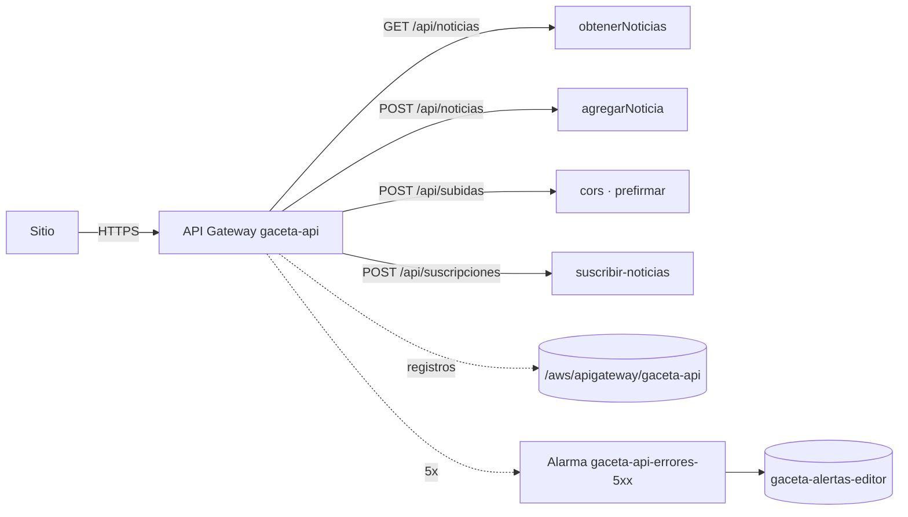

# API de la gaceta con Amazon API Gateway

Objetivo: una sola API (`gaceta-api`, HTTP API de API Gateway) en lugar de las cuatro URL de función de Lambda, y después servirla por CloudFront en `/api/*` para que el sitio y la API compartan dominio.

Región us-east-2, cuenta 216728240051. Las Lambdas **no cambian**: ya leen `event.requestContext.http.method` (carga 2.0) y decodifican cuerpos en base64.

## Recursos desplegados (fase 1, 2026-11-23)

| Recurso | Valor |
|---|---|
| API | `gaceta-api` · HTTP API · ID `2ylmuzunr2` · IPv4 |
| URL base | `https://d27gjonf76v1aq.cloudfront.net/api` (sitio en CloudFront) · `https://2ylmuzunr2.execute-api.us-east-2.amazonaws.com/api` (`API_DIRECTA`: sitio S3 y pruebas locales) |
| Etapa | `$default`, implementación automática |
| Integraciones | `obtenerNoticias`, `agregarNoticia`, `cors`, `suscribir-noticias` (carga 2.0). Cada Lambda tiene un permiso limitado a su ruta: `arn:aws:execute-api:us-east-2:216728240051:2ylmuzunr2/*/*/api/<ruta>` |
| Registros de acceso | `/aws/apigateway/gaceta-api`, retención 14 días |
| Alarma | `gaceta-api-errores-5xx` → `gaceta-alertas-editor` (ALARM y OK) |
| `enviar-correos` | Plantilla con alarmas de API Gateway desplegada (CodeSha256 `AoP1vFKJTgFXH+z3QM7TdtqzjiXzNLjD5IMym/jN3LU=`) |

## Fases

| Fase | Qué cambia | Visible para lectores | Estado |
|---|---|---|---|
| 1 | Crear `gaceta-api` en paralelo, con CORS, límites, registros y alarma | No | **Hecha** (2026-11-23) |
| 2 | `API_BASE` en `js/main.js` apunta a la API; subir el sitio | Sí (misma funcionalidad) | **Hecha** (2026-11-23) |
| 3 | Comportamiento `/api/*` en CloudFront; `API_BASE = '/api'` desde CloudFront | Sí | **Hecha** (2026-11-24) |
| 4 | Retirar las URL de función | No | **Hecha** (2026-11-24): bloqueadas con `AWS_IAM` |
| 5 | Autorizador JWT de Cognito en las rutas del editor | Sí (inicio de sesión del editor) | **Hecha** (2026-11-24) |

**Volver atrás:**
- **Fase 3:** quitar el comportamiento `/api/*` y fijar `API_BASE = API_DIRECTA`.
- **Fases 2 y 4:** devolver las URL de función a `--auth-type NONE` y restaurar `js/main.js` desde el commit anterior a la fase 2.

En todos los casos hay que cambiar el `?v=` en `index.html`, subir los archivos e invalidar CloudFront.

## Diseño



| Ruta | Lambda | Sustituye a | Límite (por segundo / ráfaga) |
|---|---|---|---|
| `GET /api/noticias` (y `?id=`) | `obtenerNoticias` | `API_NOTICIAS.obtener` | predeterminado 20 / 40 |
| `POST /api/noticias` | `agregarNoticia` | `API_NOTICIAS.agregar` | 2 / 5 |
| `POST /api/subidas` | `cors` | `API_NOTICIAS.prefirmar` | 2 / 5 |
| `POST /api/suscripciones` | `suscribir-noticias` | `API_NOTICIAS.suscribir` | 1 / 2 |

- **Prefijo `/api` en las rutas, no en la etapa:** con la etapa `$default`, la misma ruta sirve directamente (`https://<id>.execute-api.us-east-2.amazonaws.com/api/noticias`) y por CloudFront (`https://d27gjonf76v1aq.cloudfront.net/api/noticias`) sin reescribir rutas.
- **Límites bajos en las rutas que escriben o mandan correo:** frenan el abuso de formularios (el envío de confirmaciones de SNS tiene costo y reputación). Cuando API Gateway los aplica responde 429 `{"message":"Too Many Requests"}`, que el sitio ya muestra como error.
- **Sin autenticación en esta fase:** igual que hoy con las URL de función. Ver la fase 5.

## Fase 1 · Crear la API (consola)

### 1. API e integraciones

1. **API Gateway › Create API › HTTP API › Build**.
2. **Integrations › Add integration › Lambda**, región `us-east-2`, versión de carga **2.0**. Agrega las cuatro: `obtenerNoticias`, `agregarNoticia`, `cors`, `suscribir-noticias`.
3. **API name:** `gaceta-api`.
4. **Configure routes:** las cuatro rutas de la tabla, cada una con su Lambda.
5. **Configure stages:** deja `$default` con **Auto-deploy** activado.
6. **Create**. Anota el **Invoke URL** (`https://<id>.execute-api.us-east-2.amazonaws.com`) y el **API ID**.

La consola agrega a cada Lambda el permiso `lambda:InvokeFunction` para `apigateway.amazonaws.com`. Compruébalo en **Lambda › <función> › Configuración › Permisos › Política basada en recursos**: debe aparecer una instrucción con `AWS:SourceArn` = `arn:aws:execute-api:us-east-2:216728240051:<id>/*/*/api/...`.

### 2. CORS

**gaceta-api › CORS › Configure**:

| Campo | Valor |
|---|---|
| Access-Control-Allow-Origin | `https://d27gjonf76v1aq.cloudfront.net`, `http://906-unsis-daniel.s3-website.us-east-2.amazonaws.com`, `http://localhost:8000` (solo durante las pruebas) |
| Access-Control-Allow-Methods | `GET`, `POST`, `OPTIONS` |
| Access-Control-Allow-Headers | `content-type` |
| Access-Control-Max-Age | `300` |
| Access-Control-Allow-Credentials | No |

Con CORS configurado, API Gateway responde él mismo la verificación previa (`OPTIONS`) y agrega los encabezados a las respuestas de las Lambdas. No hace falta tocar el CORS de las URL de función.

### 3. Límites

1. **gaceta-api › Proteger › Limitación controlada › `$default` › Limitación controlada de ruta predeterminada › Editar:** límite de tasa 20, límite de ampliación (ráfaga) 40.
2. **Límites por ruta:** la consola no permite crearlos («Utilice la CLI o un SDK»). Desde CloudShell:

   ```bash
   aws apigatewayv2 update-stage --api-id 2ylmuzunr2 --stage-name '$default' --route-settings '{"POST /api/noticias":{"ThrottlingBurstLimit":5,"ThrottlingRateLimit":2},"POST /api/subidas":{"ThrottlingBurstLimit":5,"ThrottlingRateLimit":2},"POST /api/suscripciones":{"ThrottlingBurstLimit":2,"ThrottlingRateLimit":1}}'
   ```

   Una vez creados, ya aparecen en la consola y se pueden editar ahí.

El límite es aproximado: API Gateway reparte el cupo entre sus nodos. En una ráfaga de 20 POST simultáneos a `/api/suscripciones` (ráfaga 2), rechazó 3 con 429, no 18. Frena el abuso sostenido, no cada pico.

### 4. Registros de acceso

1. **CloudWatch › Log groups › Create log group:** `/aws/apigateway/gaceta-api`, retención 14 días (igual que las Lambdas).
2. **gaceta-api › Monitor › Logging › `$default` › Edit:** activa **Access logging**, pega el ARN del grupo (sin `:*` al final) y en **Log format** pega el JSON de `documentacion/api-gateway/formato-logs.json`.

Se hizo desde CloudShell así:

```bash
aws logs create-log-group --log-group-name /aws/apigateway/gaceta-api
aws logs put-retention-policy --log-group-name /aws/apigateway/gaceta-api --retention-in-days 14
jq -cn --arg d arn:aws:logs:us-east-2:216728240051:log-group:/aws/apigateway/gaceta-api \
  --arg f "$(cat formato-logs.json)" '{DestinationArn:$d,Format:$f}' > logs.json
aws apigatewayv2 update-stage --api-id 2ylmuzunr2 --stage-name '$default' --access-log-settings file://logs.json
```

Para leer los registros como tabla:

```bash
aws logs filter-log-events --log-group-name /aws/apigateway/gaceta-api --query 'events[-20:].message' --output json \
  | jq -r '.[] | fromjson | [.fecha,.ruta,.estado,.latenciaMs,.error] | @tsv'
```

Cada petición deja una línea con ruta, estado, latencia total, latencia de la Lambda y el error de integración si lo hubo. No registra cuerpos, así que los correos de los suscriptores no quedan en los registros.

### 5. Alarma de errores 5xx

**CloudWatch › Alarms › Create alarm › Select metric › ApiGateway › ApiId, Stage** → `gaceta-api` · `$default` · **5xx**:

| Campo | Valor |
|---|---|
| Estadística / periodo | Sum / 5 minutos |
| Condición | Mayor o igual que 1 |
| Datos faltantes | Tratar como **correctos** (no infringe) |
| Notificación | En modo alarma y Correcto → `gaceta-alertas-editor` |
| Nombre | `gaceta-api-errores-5xx` |

El correo lo arma `enviar-correos`. Su plantilla (`lambdas/enviar-correos/plantillas-correo.mjs`, `correoAlarma`) ahora reconoce el espacio de nombres `AWS/ApiGateway`: el título dice «La API de la gaceta está fallando» y el botón **Ver los logs** abre `/aws/apigateway/gaceta-api`. **Sube esa versión de `enviar-correos` antes de crear la alarma**; con la anterior el correo diría «La procesadora de noticias está fallando».

Un 5xx aparece cuando una Lambda falla, excede su tiempo o devuelve 500. Los 4xx (validaciones, 429 por límite) no disparan la alarma.

La alarma nace en «Datos insuficientes» y pasa a **Correcto** a los pocos minutos. Esa transición manda un correo «La API de la gaceta se recuperó» al editor; es esperado.

Se creó con `aws cloudwatch put-metric-alarm`: dimensiones `ApiId=2ylmuzunr2` y `Stage=$default`, `--treat-missing-data notBreaching`, y `--alarm-actions` y `--ok-actions` hacia `gaceta-alertas-editor`. La plantilla se desplegó reemplazando solo `plantillas-correo.mjs` en el paquete actual de `enviar-correos` (antes se comprobó que el paquete era idéntico al repositorio).

### 6. Comprobación

```bash
bash pruebas/api-gateway.sh https://<id>.execute-api.us-east-2.amazonaws.com/api
```

El script no escribe datos: los POST llevan cuerpos inválidos que cada Lambda rechaza con 400 antes de tocar DynamoDB, S3 o SNS.

| Prueba | Qué comprueba | Esperado |
|---|---|---|
| A01 | `GET /api/noticias` | 200 |
| A02 | `GET /api/noticias?id=<uuid inexistente>` | `{"estado":"pendiente",…}` |
| A03 | Verificación previa CORS desde CloudFront | 204 |
| A04 | `access-control-allow-origin` del sitio | presente |
| A05 | Origen ajeno | sin encabezado CORS |
| A06 | `POST /api/noticias` con `{}` | 400 de `agregarNoticia` |
| A07 | `POST /api/subidas` con `{}` | 400 de `cors` |
| A08 | `POST /api/suscripciones` con correo inválido | 400 de `suscribir-noticias` |
| A09 | `DELETE /api/noticias` (ruta inexistente) | 404 de API Gateway |

Después, en **CloudWatch › `/aws/apigateway/gaceta-api`** deben aparecer las 9 peticiones.

**Resultado 2026-11-23:**
- Antes de configurar CORS pasaron 7 de 9; fallaban A03 y A04, como se esperaba.
- Con CORS configurado pasaron las 9.
- La verificación previa desde el sitio S3 hacia `/api/suscripciones` devuelve el origen, `GET,OPTIONS,POST`, `content-type` y `max-age 300`.
- Los registros de acceso muestran cada petición con ruta, estado y latencia, incluidos los 429 del límite.

**Prueba del sitio completo sin publicarlo:** pon temporalmente `API_BASE = 'https://<id>.execute-api.us-east-2.amazonaws.com/api'` en `js/main.js`, ejecuta `python3 -m http.server 8000` en la raíz del repositorio y abre `http://localhost:8000`. Carga la lista, publica una noticia de prueba con imagen y otra sin imagen, y suscribe un correo propio. **Ojo:** cada noticia publicada se avisa por SNS a todos los suscriptores confirmados. Para no mandarles correos de prueba, quita antes la variable `TOPICO_NOTICIAS_ARN` de `agregarNoticia` y de `procesar-imagen-noticia` y vuelve a ponerla al terminar. En la pestaña Red, todas las llamadas deben ir a `execute-api`. Borra las noticias de prueba de la tabla `noticias` al terminar.

## Fase 2 · Cambiar el sitio a la API

1. En `js/main.js`, `API_BASE = 'https://<id>.execute-api.us-east-2.amazonaws.com/api'`.
2. En `index.html`, cambia `js/main.js?v=…` (por ejemplo, `?v=api-gateway-1`).
3. Sube `index.html` y `js/main.js` a `906-unsis-daniel`.
4. CloudFront › `E1HSACVXW4XMRE` › Invalidations: `/index.html`, `/`, `/js/main.js`.
5. Repite las pruebas del sitio en `https://d27gjonf76v1aq.cloudfront.net` y en el sitio S3.

### Resultado (2026-11-23)

**Prueba local** (`http://localhost:8000`, con `TOPICO_NOTICIAS_ARN` quitada de `agregarNoticia` y `procesar-imagen-noticia`):

| Flujo | Resultado |
|---|---|
| Cargar lista | `GET /api/noticias` 200. Los mismos 17 registros que la URL de función; los 2 «omitidos» ya existían |
| Noticia sin imagen | `POST /api/noticias` 201; la lista pasa a 16 |
| Noticia con imagen | `POST /api/subidas` 200 (en el registro de acceso), subida a S3, la procesadora la guarda y `GET ?id=` la confirma; la foto sale por CloudFront |
| Suscripción con correo inválido | Verificación previa 204 y mensaje de validación de `suscribir-noticias` (no llama a SNS) |

**Después de la prueba:**
- Se borraron las 2 noticias de prueba de `noticias` y sus 2 objetos de S3 (`imagenes/13a4437a-…/foto.webp` y `pendientes/13a4437a-….json`).
- Se restauraron las variables originales de las dos Lambdas; se comparó cada una con su respaldo.

**Publicación:**
1. Antes de subir se comprobó que `index.html` y `js/main.js` del bucket eran idénticos al repositorio.
2. Se subió `main.js` (`application/javascript`) y después `index.html` (`text/html`), con `?v=api-gateway-1`.
3. Invalidación `I4VLA2JIBZUWMTHUVTYYS4KRRK`: `/index.html`, `/`, `/js/main.js` y la foto de prueba.

**Verificación en el navegador:**
- CloudFront y sitio S3: 15 noticias por `execute-api`, ninguna llamada a las URL de función y ninguna imagen rota.
- En CloudFront, 10 fotos y ningún error en la consola.

`solicitarJSON` recibe ahora qué Lambda se llama (`'obtener'`, `'agregar'`, `'prefirmar'`, `'suscribir'`). Antes la deducía de la URL, y con API Gateway todas comparten dominio (y `obtener` y `agregar` hasta la misma URL).

## Fase 3 · API por CloudFront en `/api/*`

Hecha el 2026-11-24 en la distribución `E1HSACVXW4XMRE`, desde CloudShell:

1. `aws cloudfront get-distribution-config` → `actual.json`.
2. Con `jq` se agregó el origen y el comportamiento, y se comprobó que el resto de la configuración quedaba igual.
3. Se aplicó con `aws cloudfront update-distribution --if-match <ETag>`.

| Elemento | Valor |
|---|---|
| Origen `gaceta-api` | `2ylmuzunr2.execute-api.us-east-2.amazonaws.com`, solo HTTPS, TLS 1.2, sin ruta de origen |
| Comportamiento `/api/*` | Orden 0. Origen `gaceta-api`. Espectador: solo HTTPS. Métodos GET, HEAD, OPTIONS, PUT, POST, PATCH, DELETE |
| Caché | **CachingDisabled** (`4135ea2d-…`) |
| Solicitud de origen | **AllViewerExceptHostHeader** (`b689b0a8-…`): API Gateway rechaza el `Host` de CloudFront |

**Frontend:** `API_BASE = location.hostname.endsWith('.cloudfront.net') ? '/api' : API_DIRECTA`.
- Desde CloudFront la petición es del mismo origen y no hay verificación previa CORS.
- El sitio S3 y `localhost` siguen llamando a `execute-api` directamente.

**Comprobación:** `bash pruebas/api-gateway.sh https://d27gjonf76v1aq.cloudfront.net/api` → 9 de 9. Las respuestas traen `apigw-requestid` y `x-cache: Miss from cloudfront`.

**Decisiones:**
- **Sin caché de la lista:** después de publicar, el sitio recarga la lista y muestra «Noticia publicada correctamente». Con 30 s de caché, el editor no vería su noticia. El costo de un `Scan` por visita es insignificante con 17 noticias.
- **Páginas de error de la distribución:** las respuestas 403 y 404 de la distribución muestran `/error.html` también en `/api/*`, con el mismo código. Las rutas de la API no devuelven 403 ni 404 en uso normal; una ruta inexistente sigue devolviendo 404, ahora con HTML.
- **`execute-api` sigue accesible directamente:** el sitio S3 lo necesita. Cerrarlo exigiría un encabezado secreto de CloudFront y un autorizador Lambda, y no aporta seguridad mientras las rutas sean públicas. Ver la fase 5.

## Fase 4 · Retirar las URL de función

Hecha el 2026-11-24.

1. **Tráfico:** la métrica `AWS/Lambda › UrlRequestCount` de las cuatro funciones marca 0 desde la publicación de la fase 2 (2026-11-23 23:00 UTC). La misma consulta sí muestra el tráfico anterior, así que la métrica funciona.
2. **Bloqueo:** las cuatro URL de función (`obtenerNoticias`, `agregarNoticia`, `cors`, `suscribir-noticias`) pasaron a **AuthType `AWS_IAM`**:

   ```bash
   aws lambda update-function-url-config --function-name <función> --auth-type AWS_IAM
   ```

   Ahora responden 403 a cualquier petición sin firma de IAM. No se eliminaron: al recrear una URL de función AWS asigna otra dirección. Bloqueadas, la vuelta atrás es inmediata (`--auth-type NONE`) y conserva las mismas URL y su CORS.
3. **Frontend:** `js/main.js` ya no contiene las URL de función. Se publicó junto con la fase 3 (`?v=api-gateway-2`, invalidación `I01PUXKLNUTNSFP7TKAJKE7ICX`).
4. **`http://localhost:8000` se queda en el CORS de la API:** permite probar el sitio en local contra la API real. En una API pública sin autenticación, CORS no es un control de acceso: cualquiera puede llamarla con `curl`. Con la fase 5, `http://localhost:8000/` también es dirección de retorno de Cognito, para probar el inicio de sesión en local.

**Comprobación:** las cuatro URL de función → 403. `pruebas/api-gateway.sh` → 9 de 9 por CloudFront (`/api`) y por `execute-api`. Sitio S3 y sitio CloudFront: 15 noticias, ninguna llamada a `lambda-url` y ningún error en la consola. La suscripción desde CloudFront hace un POST del mismo origen, sin verificación previa.

**Eliminar del todo (opcional, más adelante):** en cada función, **Configuración › URL de función › Eliminar**, y quitar de su política basada en recursos la instrucción `FunctionURLAllowPublicAccess`. Ya no hay vuelta atrás con las mismas URL.

## Fase 5 · Inicio de sesión del editor con Amazon Cognito

Hecha el 2026-11-24. Publicar (`POST /api/noticias` y `POST /api/subidas`) exige el token de acceso de un editor. Leer noticias y suscribirse siguen siendo públicos.

| Recurso | Valor |
|---|---|
| Grupo de usuarios | `gaceta-editores` · `us-east-2_7l3XrSXEJ`. Inicio de sesión con correo. **Solo el administrador crea cuentas.** Contraseña de 10+ caracteres con mayúscula, minúscula y número. Recuperación por correo verificado. Protección contra borrado activa |
| Cliente de aplicación | `gaceta-sitio` · `1tb60jodoksecg5tfki9b1kb4f`. Público (sin secreto). Flujo de código de autorización con PKCE, alcances `openid email`. Tokens de acceso e ID de 60 min |
| Direcciones de retorno y salida | `https://d27gjonf76v1aq.cloudfront.net/` y `http://localhost:8000/` |
| Dominio de inicio de sesión | `https://gaceta-unsis-editores.auth.us-east-2.amazoncognito.com` (inicio de sesión clásico, versión 1) |
| Autorizador | `cognito-editores` (`nazs3g`), tipo JWT. Emisor `https://cognito-idp.us-east-2.amazonaws.com/us-east-2_7l3XrSXEJ`, audiencia = cliente, fuente `$request.header.Authorization`. Conectado a `POST /api/noticias` y `POST /api/subidas` |
| CORS de la API | Se agregó el encabezado `authorization` |
| Editor | Cuenta del responsable del proyecto, creada con `admin-create-user` (invitación con contraseña temporal por correo; al primer inicio de sesión elige la suya) |

**En el sitio** (`index.html`, `js/main.js`, `css/styles.css`):

- **Lector (sin sesión):** el sitio no muestra nada de edición. No aparece «Crear noticia» ni en el menú ni en la página (clase `solo-editor`). El encabezado solo tiene, a la derecha, un botón discreto «Editores» con candado (en celular, solo el candado).
- **Inicio de sesión:** «Editores» genera el verificador y el reto PKCE y lleva a la página de Cognito. Al volver, el sitio cambia el código por los tokens en `/oauth2/token`, guarda el token de acceso **solo en `sessionStorage` de esa pestaña**, limpia la dirección y baja al formulario.
- **Modo editor (con sesión):**
  - `<html>` lleva la clase `modo-editor`, y la cornisa del encabezado pasa de rojo a maíz.
  - Bajo el encabezado aparece una franja fija «MODO EDITOR» con el enlace «Crear noticia».
  - En el menú aparece «Crear noticia» y se muestra la sección con el formulario.
  - En lugar de «Editores» aparece un chip con la inicial del editor. Su menú muestra el correo, la hora de vencimiento, «Crear noticia» y «Cerrar sesión».
  - Al publicar se manda `Authorization: Bearer <token>`.
- **Vencimiento:**
  - Un temporizador saca al sitio del modo editor cuando vence la sesión. Un 401 de la API hace lo mismo.
  - En ambos casos aparece un aviso flotante con «Iniciar sesión».
  - Lo escrito (título, fecha, categoría, detalle y descripción de la imagen) se guarda en `sessionStorage` al iniciar sesión y se restaura al volver. La imagen hay que volver a elegirla: el navegador no permite restaurar un campo de archivo.
- **Cerrar sesión:** borra el token y cierra la sesión de Cognito.
- **Sitio S3 (HTTP):** Cognito no admite una dirección de retorno HTTP, así que ahí «Editores» es un enlace al sitio de CloudFront.

**Agregar otro editor:** Cognito › `gaceta-editores` › Usuarios › Crear usuario (invitación por correo, correo marcado como verificado). O, desde CloudShell:

```bash
aws cognito-idp admin-create-user --user-pool-id us-east-2_7l3XrSXEJ --username <correo> \
  --user-attributes Name=email,Value=<correo> Name=email_verified,Value=true --desired-delivery-mediums EMAIL
```

**Volver atrás (publicar sin sesión):**
1. Quitar el autorizador de las dos rutas: `aws apigatewayv2 update-route --api-id 2ylmuzunr2 --route-id <id> --authorization-type NONE`.
2. Restaurar `js/main.js` e `index.html` del commit anterior a la fase 5.

**Comprobación:** `bash pruebas/api-gateway.sh <base>` (A01–A11). Sin token y con un token falso, los POST del editor responden 401. La verificación previa CORS permite `authorization`.

**Comprobación con sesión real (2026-11-24):**
- El editor inició sesión en el sitio de CloudFront y su cuenta quedó en `CONFIRMED`.
- Con su token, `POST /api/noticias` y `POST /api/subidas` con cuerpo `{}` pasan el autorizador y llegan a la Lambda. Responden 400 («Faltan título, detalle, fecha o categoría.» y «Archivo no válido»), no 401.
- No se creó ninguna noticia ni se avisó a los suscriptores.
- En el sitio, el formulario se habilita y aparece «Cerrar sesión».

## Costos

- HTTP API: alrededor de 1 USD por millón de peticiones. Con el tráfico de la gaceta es prácticamente cero.
- Registros de acceso: unos cientos de bytes por petición, con 14 días de retención.
- Alarma: una alarma estándar.
- Cognito: el plan Essentials incluye 10 000 usuarios activos al mes sin costo; la gaceta usa uno.

## Limpieza

1. Quitar la protección contra borrado del grupo `gaceta-editores` y eliminarlo, junto con su dominio.
2. Eliminar la alarma `gaceta-api-errores-5xx`, el grupo de registros `/aws/apigateway/gaceta-api` y la API `gaceta-api`.
3. Quitar de cada Lambda la instrucción de política basada en recursos de `apigateway.amazonaws.com`.
4. Quitar de CloudFront el comportamiento `/api/*` y el origen `gaceta-api`.
5. Devolver las URL de función a `NONE` y restaurar `js/main.js` con las URL de función (ver «Volver atrás»).
