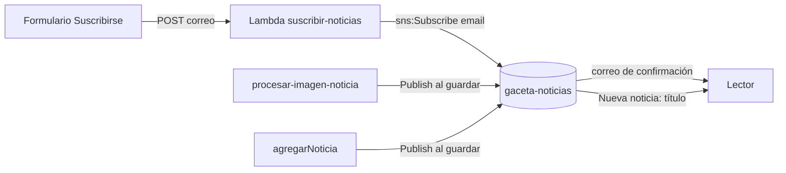

# Notificaciones por correo con Amazon SNS

Implementado el 20 de noviembre de 2026 en us-east-2 (cuenta 216728240051).

## Temas

| Tema | Nombre visible | Para qué | Quién publica |
|---|---|---|---|
| `gaceta-noticias` | El Unsito | Aviso a lectores de cada noticia nueva | `procesar-imagen-noticia` (noticias con imagen) y `agregarNoticia` (sin imagen) |
| `gaceta-alertas-editor` | Alertas El Unsito | Alertas operativas al editor | Alarma `gaceta-procesadora-errores` (ALARM y OK) y la procesadora cuando rechaza una publicación |

Ambos son temas estándar, sin cifrado, con la política de acceso predeterminada (solo el propietario publica).

## Flujo de lectores

- El lector escribe su correo en la sección **Suscribirse** del sitio. `suscribir-noticias` valida el formato y llama a `sns:Subscribe`; AWS envía el correo de confirmación. Sin confirmar no recibe nada.
- Al guardar una noticia (escritura condicional nueva, no duplicados), la función publica asunto `Nueva noticia: <título>` y un cuerpo con categoría, fecha, resumen de 600 caracteres y enlace `#nota-<id>`. SNS agrega el enlace para darse de baja.
- Un fallo de SNS solo se registra (`notificacion_fallida`); no deshace ni reintenta la noticia.

## Flujo del editor

- La alarma `gaceta-procesadora-errores` notifica a `gaceta-alertas-editor` al entrar en **En modo alarma** y al volver a **Correcto**.
- La procesadora publica `El Unsito: noticia rechazada por la procesadora` cuando una validación falla (`validacion_fallida`). Esos rechazos no relanzan el error y por eso la alarma no los ve.
- Editor suscrito: el correo del responsable del proyecto (confirmado).

## Recursos en AWS

| Recurso | Cambio |
|---|---|
| `procesar-imagen-noticia` | Código nuevo (`lambdas/procesar-imagen.mjs`); variables `TOPICO_NOTICIAS_ARN` y `TOPICO_ALERTAS_ARN` |
| Rol `procesar-imagen-noticia-rol` | Política `ProcesadoraMinimoPrivilegio` con `sns:Publish` sobre los dos temas (`documentacion/iam/procesadora-politica.json`) |
| `agregarNoticia` | Código nuevo (`lambdas/agregar-noticia.mjs`); variable `TOPICO_NOTICIAS_ARN`. Su rol `PowerUserRole` ya permite `sns:Publish` |
| `suscribir-noticias` (nueva) | Node.js 26.x, `index.handler`, variable `TOPICO_NOTICIAS_ARN`. Desde el 2026-11-24 se llama por API Gateway (`POST /api/suscripciones`); su URL de función `https://jneqwan7m2p3sjely2talw4rvm0infnt.lambda-url.us-east-2.on.aws/` está bloqueada con AWS_IAM (ver INTEGRACION-API-GATEWAY.md) |
| Bucket `906-unsis-daniel` | `index.html`, `js/main.js` y `css/styles.css` actualizados |

`suscribir-noticias` quedó con el rol que la cuenta asigna por defecto (`PowerUser-lambda-1`, PowerUserAccess). Para mínimo privilegio, crear un rol con `documentacion/iam/suscribir-politica.json` y asignarlo en **Configuración > Permisos**.

Sin las variables `TOPICO_*` las funciones se comportan como antes y no envían correos.

## Pruebas

1. **Suscripción:** en el sitio, sección Suscribirse, enviar un correo → mensaje «Te enviamos un correo de confirmación…»; en SNS > Suscripciones aparece «Pendiente de confirmación». Un correo inválido devuelve «Escribe un correo electrónico válido.» (comprobado el 20/11/2026).
2. **Aviso de noticia:** confirmar la suscripción, publicar una noticia con imagen → llega «Nueva noticia: …»; en los logs aparece `notificacion_enviada`.
3. **Duplicado (P07):** volver a probar el mismo evento → `duplicado` y no llega un segundo correo.
4. **Rechazo (P03):** evento con pendiente inválido → el editor recibe «noticia rechazada».
5. **Alarma (P04–P06):** forzar el fallo con `TABLA` inexistente → el editor recibe ALARM y, al restaurar, OK.

## Limpieza

Eliminar `suscribir-noticias` y su rol, los temas `gaceta-noticias` y `gaceta-alertas-editor` (borra sus suscripciones), quitar las acciones de la alarma y las variables `TOPICO_*`, y la instrucción `PublicarNotificaciones` de la política de la procesadora.
