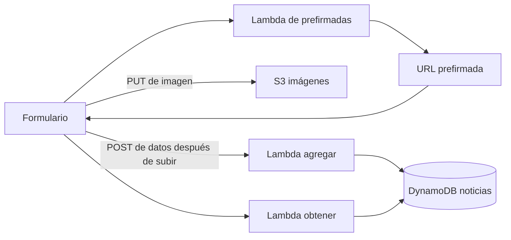

# Integración pendiente — Equipo 3: Monitoreo y resiliencia

Proyecto: Gaceta Universitaria «El Unsito», UNSIS.
Fecha de diagnóstico: 26 de octubre de 2026.

> **Actualización 2026-10-27:** la integración S3 → Lambda → DynamoDB, los logs, la alarma y las pruebas P01–P08 se implementaron y aprobaron en AWS. Ver [documentacion/MANUAL-IMPLEMENTACION.md](documentacion/MANUAL-IMPLEMENTACION.md) (PDF con capturas en `documentacion/MANUAL-IMPLEMENTACION.pdf`) y [documentacion/MATRIZ-PRUEBAS.md](documentacion/MATRIZ-PRUEBAS.md). Pendientes opcionales: DLQ en SQS, notificación SNS, caducidad de `pendientes/` y rol de mínimo privilegio para la procesadora.

Este diagnóstico se basa en el código local y en las pruebas reportadas durante el desarrollo. No certifica la configuración desplegada en AWS. No se asigna un porcentaje de avance sin evidencias de consola.

## 1. Recursos identificados

| Recurso | Nombre o función |
|---|---|
| Región | us-east-2, Ohio |
| Bucket del sitio | 906-unsis-daniel |
| Bucket de imágenes | mis-noticias-daniel-imagenes-906-2026 |
| DynamoDB | noticias; el código supone clave primaria id de tipo String |
| Lambda de prefirmadas | Genera uploadUrl para un archivo recibido mediante POST ?file=nombre |
| Lambda de agregar | Valida el JSON recibido por HTTP y guarda la noticia |
| Lambda de obtener | Consulta la tabla y genera URLs de lectura para las imágenes |

Los nombres reales de las funciones, sus ARN, roles, límites, saldo y configuración deben registrarse desde AWS Academy/Learner Lab. El código de la Lambda de prefirmadas todavía debe incorporarse al repositorio; actualmente se conserva en AWS y fue compartido en la conversación.

## 2. Lo que ya existe

- [x] Formulario de título, fecha, categoría, detalle e imagen opcional.
- [x] Solicitud de URL prefirmada y subida mediante PUT; el usuario confirmó la subida de imágenes.
- [x] Código de guardado y consulta en DynamoDB.
- [x] Lectura de imágenes mediante URLs prefirmadas temporales.
- [x] Compatibilidad con noticias antiguas con detalle o detalles.
- [x] Validación y mensajes de error en el navegador.
- [x] Escritura condicional por id y reutilización del identificador al reintentar desde el formulario.
- [x] Registros básicos console.error en las Lambda.

La existencia del código no equivale a una prueba de extremo a extremo aprobada en AWS. Capturar publicación, registro en DynamoDB y consulta después de recargar.

## 3. Arquitectura actual

El navegador todavía llama directamente a la Lambda de agregar después de subir la imagen. El handler de agregar no procesa eventos event.Records de S3. Agregar un disparador sin adaptar el contrato no resuelve la integración.

## 4. Arquitectura objetivo y datos

Propuesta por implementar, no desplegada:

1. Antes de subir, el navegador envía los datos de la noticia a la Lambda de prefirmadas.
2. Esa Lambda valida y asigna un id estable; guarda pendientes/ID.json en S3.
3. Devuelve uploadUrl, noticiaId y la clave imagenes/ID/foto.ext.
4. El navegador sube la imagen con PUT.
5. Un evento ObjectCreated del prefijo imagenes/ activa una nueva Lambda procesadora.
6. La procesadora obtiene pendientes/ID.json, valida y guarda en DynamoDB con el mismo id.
7. La web consulta el resultado durante un tiempo limitado y distingue procesamiento pendiente, éxito y fallo. Una subida exitosa no implica que la noticia ya esté guardada.

Usar JSON separado evita guardar contenido largo en metadatos HTTP del objeto S3, que tienen un límite de 2 KB para metadatos definidos por el usuario.

Decisiones pendientes:

- [ ] Confirmar el contrato del JSON: id, titulo, detalle, fecha, categoria, imagen/key y alt.
- [ ] Definir si las noticias sin imagen se mantienen y qué evento inicia su procesamiento; no dispararán el evento de imagen.
- [ ] Definir estados y consulta por id; evitar consultar toda la tabla repetidamente para seguir una publicación.
- [ ] Definir retención o limpieza de pendientes e imágenes sin noticia; conservar información suficiente para reintentar fallos.
- [ ] Definir el comportamiento si se repite un id con contenido diferente.

## 5. Lista de integración por prioridad

### A. Diagnóstico en AWS

- [ ] Verificar permisos del laboratorio, región y saldo inicial.
- [ ] Registrar nombres/ARN de funciones, buckets, tabla y roles.
- [ ] Comprobar publicación y lectura actuales con una noticia de prueba.
- [ ] Guardar capturas del flujo inicial y su configuración CORS.

### B. S3 → Lambda y DynamoDB

- [ ] Incorporar al repositorio la Lambda de prefirmadas desplegada.
- [ ] Adaptarla para recibir datos y guardar el JSON antes de emitir uploadUrl.
- [ ] Crear la procesadora S3 sin interrumpir primero el flujo existente.
- [ ] Procesar todos los Records, decodificar claves y recuperar el JSON.
- [ ] Validar origen y campos; escribir con id estable y condición attribute_not_exists(id).
- [ ] Configurar ObjectCreated con prefijo imagenes/ y permiso para que S3 invoque la función.
- [ ] Mantener bucket y función en us-east-2; evitar que salidas de la procesadora activen el mismo disparador.
- [ ] Probar duplicados y decidir cuándo retirar la llamada HTTP de agregar del frontend.
- [ ] Cambiar el frontend para mostrar procesamiento asíncrono y consultar su resultado.

### C. Logs y métricas

- [ ] Comprobar permisos de CloudWatch Logs del rol de la procesadora.
- [ ] Registrar JSON de inicio, validación, éxito, duplicado y fallo con noticiaId, requestId, bucket, key y duración cuando corresponda.
- [ ] Evitar registrar firmas de URLs, secretos o el contenido completo de las noticias.
- [ ] Verificar /aws/lambda/NOMBRE y fijar retención de logs acorde al laboratorio.
- [ ] Visualizar Invocations, Errors y Duration filtradas por la procesadora.
- [ ] Crear alarma Errors: Sum >= 1, periodo 1 minuto, 1 de 1 periodos; definir datos ausentes como no infractores para esta prueba de laboratorio.
- [ ] Si se permite SNS, configurar notificación y confirmar la suscripción.

Los handlers HTTP actuales capturan excepciones y devuelven statusCode 500. Eso no demuestra por sí mismo la métrica nativa Errors. En la procesadora asíncrona, registrar y relanzar los fallos operativos que deban activar Errors y reintentos. Definir explícitamente si una validación es terminal o reintentable.

### D. Resiliencia y pruebas

- [ ] Revisar edad máxima de evento y número de reintentos antes de provocar errores.
- [ ] Crear una función o configuración aislada de laboratorio para fallos controlados; no modificar ni borrar la tabla compartida.
- [ ] Probar recuperación después de corregir el fallo.
- [ ] Opcional: configurar DLQ o destino de fallo SQS y demostrar recepción y reprocesamiento.

| Prueba | Resultado y evidencia requerida |
|---|---|
| P01 Imagen válida | Log de S3 activando la procesadora sin POST posterior a agregar |
| P02 Persistencia | Registro en DynamoDB y consulta visible después de recargar |
| P03 JSON ausente/inválido | Log de validación y manejo definido, sin noticia incompleta |
| P04 Fallo de DynamoDB simulado | Log de excepción y reintentos según configuración aislada |
| P05 Errors | Incremento real en métrica nativa, no solo respuesta HTTP 500 |
| P06 Alarma | Estado ALARM asociado al fallo y recuperación documentada |
| P07 Evento duplicado | Un solo registro con el mismo id |
| P08 Procesamiento lento | Web muestra pendiente y permite consultar sin duplicar la noticia |

## 6. Permisos a comprobar

Agregar únicamente los necesarios a cada rol, según las operaciones finales:

| Componente | Permisos previstos |
|---|---|
| Prefirmadas | s3:PutObject en imagenes/* y pendientes/* |
| Procesadora | s3:GetObject en pendientes/* y, si valida el objeto, imagenes/*; dynamodb:PutItem y GetItem si consulta duplicados; permisos de logs |
| Obtener | dynamodb:Scan actual o GetItem para consulta por id; s3:GetObject en imagenes/*; logs |
| S3 como invocador | Política basada en recursos de Lambda que permita lambda:InvokeFunction restringida al bucket y cuenta |
| DLQ/destino opcional | Permisos de envío SQS y configuración específica del mecanismo elegido |

Revisar restricciones de Learner Lab antes de crear roles o políticas. Los permisos de invocación de S3, el rol de ejecución y CORS cumplen funciones diferentes. CORS no sustituye autorización para publicar. No cambiar los permisos actuales de subida sin motivo: la subida ya funciona.

## 7. Entregables y evidencias

- [ ] Diagrama inicial y final.
- [ ] Ficha técnica con nombres, región y permisos.
- [ ] Bitácora por sesión con objetivo, pasos, resultados, problemas y costos.
- [ ] Capturas de disparador S3, logs de éxito/fallo, DynamoDB, métricas y alarma.
- [ ] Matriz P01–P08 con resultado real, fecha, noticiaId y referencia a evidencia.
- [ ] Saldo inicial/final, retención, recursos temporales y limpieza prevista.
- [ ] Conclusiones y referencias; separar implementado, probado y pendiente.

Organización sugerida: documentacion/, evidencias/s3/, evidencias/lambda/, evidencias/cloudwatch/, evidencias/errores/, evidencias/costos/ y diagramas/. Ocultar secretos y firmas temporales en capturas.

## 8. Fuentes oficiales

- Eventos S3 y prevención de ciclos: https://docs.aws.amazon.com/lambda/latest/dg/with-s3.html
- Reintentos asíncronos y duplicados: https://docs.aws.amazon.com/lambda/latest/dg/invocation-async-error-handling.html
- Configuración de reintentos: https://docs.aws.amazon.com/lambda/latest/dg/invocation-async-configuring.html
- Métricas nativas: https://docs.aws.amazon.com/lambda/latest/dg/monitoring-metrics.html
- Logs y errores de ejecución: https://docs.aws.amazon.com/prescriptive-guidance/latest/implementing-logging-monitoring-cloudwatch/lambda-logging-metrics.html
- Metadatos S3: https://docs.aws.amazon.com/AmazonS3/latest/userguide/UsingMetadata.html
