# Manual de implementación — Equipo 3: Monitoreo y resiliencia

**Proyecto:** Gaceta Universitaria «El Unsito», UNSIS  
**Región:** us-east-2 (Ohio) · **Cuenta:** 2167-2824-0051 (plan gratuito con créditos)  
**Fecha de ejecución:** 27 de octubre de 2026, 23:15–23:52 UTC  
**Herramientas:** consola web de AWS en el navegador (Lambda, S3, DynamoDB, IAM, CloudWatch)

> **Nota sobre las capturas:** la implementación y las pruebas se hicieron el 27 de octubre. Las capturas originales salían borrosas, así que el 28 de octubre todas se volvieron a tomar en resolución nativa (pantalla 4K). Para eso se volvieron a abrir las mismas pantallas. Los formularios se llenaron igual y se cancelaron sin guardar. «Probar» se volvió a ejecutar con los eventos de P03 y P07, y P01 y P08 se repitieron desde el sitio. Por eso algunas pantallas muestran el estado del 28 de octubre: por ejemplo, ya aparece la procesadora en la lista de funciones y la tabla tiene más elementos. Las capturas originales del 27 se conservan en `evidencias/` como archivos `.jpg`, y las de alta resolución como `.png`.

Este manual documenta, paso a paso y con capturas reales, cómo se integró la publicación de noticias con un evento de S3 que activa una Lambda procesadora, y cómo se añadieron logs, métricas, alarma y pruebas de resiliencia. Las capturas originales están en `evidencias/` (en este manual, recortadas en `documentacion/img/`) y no contienen credenciales; las URL prefirmadas no se muestran.

## Arquitectura

**Antes:** el navegador subía la imagen con una URL prefirmada y luego llamaba por HTTP a la Lambda `agregarNoticia`.

**Después:**

1. El navegador envía los datos de la noticia a la Lambda `cors` (prefirmadas).
2. La Lambda valida, asigna un id y guarda `pendientes/ID.json` en el bucket de imágenes.
3. Devuelve `uploadUrl` para `imagenes/ID/foto.ext`.
4. El navegador sube la imagen con PUT.
5. El evento `s3:ObjectCreated:*` con prefijo `imagenes/` invoca la nueva Lambda `procesar-imagen-noticia`.
6. La procesadora lee el pendiente, valida y escribe en DynamoDB con `attribute_not_exists(id)`.
7. El navegador consulta `obtenerNoticias?id=ID` cada 2 s, hasta 10 veces, y distingue entre noticia pendiente y publicada.

Las noticias **sin imagen** siguen usando la Lambda `agregarNoticia`, porque no generan evento de S3.

---

## Fase A · Diagnóstico inicial

### A1. Saldo inicial
Página de inicio de la consola: 120,00 USD en créditos y 0,00 USD de gasto en el mes.

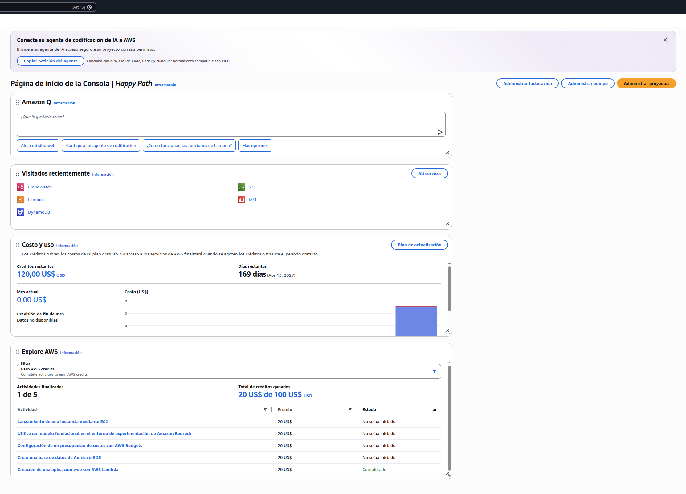

### A2. Inventario de recursos
En **Lambda > Funciones** aparecen tres funciones: `obtenerNoticias`, `agregarNoticia` y `cors`. Esta última es la que genera las URL prefirmadas.

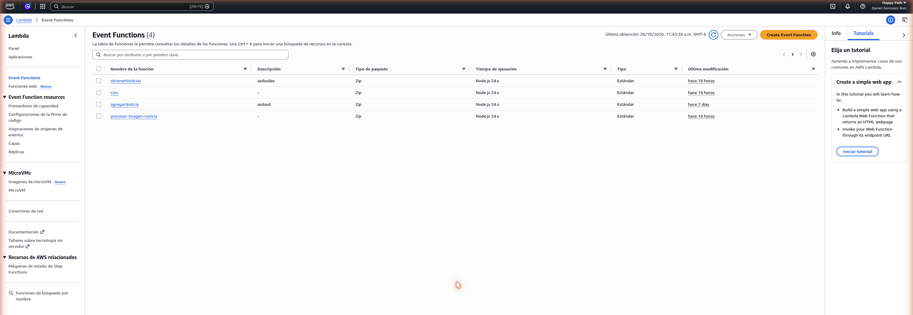

*En la recaptura del 28 de octubre ya aparece también `procesar-imagen-noticia`, creada en la fase B.*

En `cors` > **Configuración > URL de la función**, el CORS ya permite el origen del sitio, el encabezado `content-type` y los métodos POST y GET. No hizo falta cambiarlo para enviar JSON.

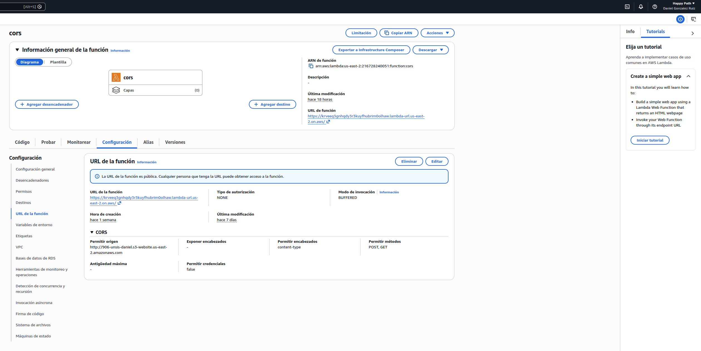

Las tres funciones usan el rol `PowerUserRole`, que tiene la política administrada `PowerUserAccess` y la política insertada `URLprefirmada`. Ese rol ya cubre S3, DynamoDB y CloudWatch Logs, así que no se modificó IAM.

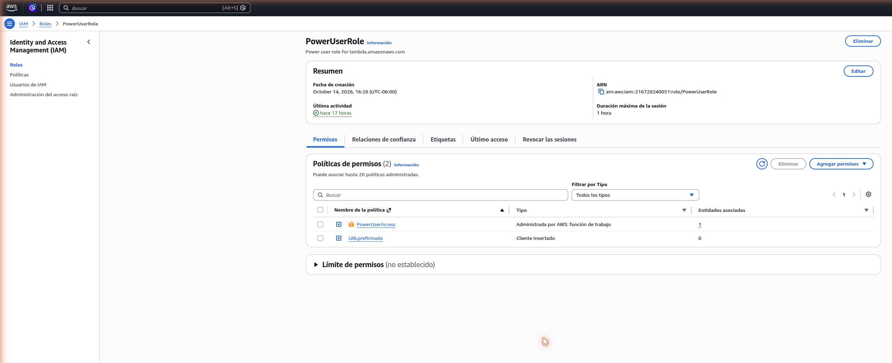

En **S3 > mis-noticias-daniel-imagenes-906-2026 > Permisos > CORS** se permite PUT, POST y GET.

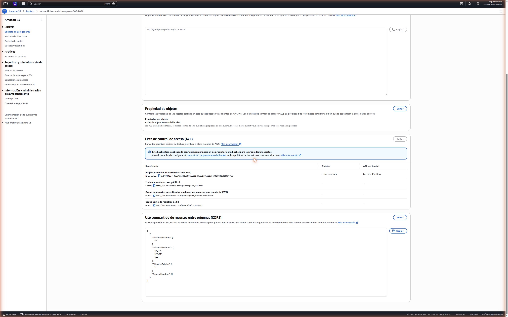

En **DynamoDB > Tablas > noticias**, la clave de partición es `id (String)`, la capacidad es bajo demanda y había 6 elementos el 27 de octubre. En la recaptura ya hay más elementos, que son las noticias de prueba.

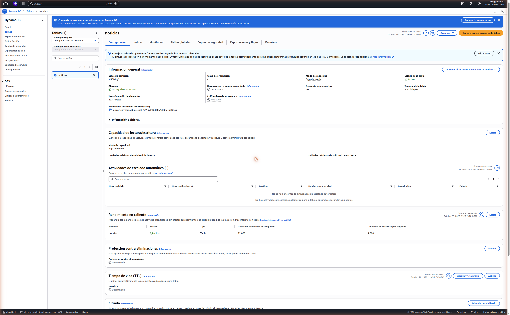

### A3. Prueba del flujo inicial
Se publicó «Prueba inicial E3 (flujo actual)» con imagen desde el sitio. Después de recargar, la noticia aparece en el sitio. En la recaptura se abrió directamente esa noticia.

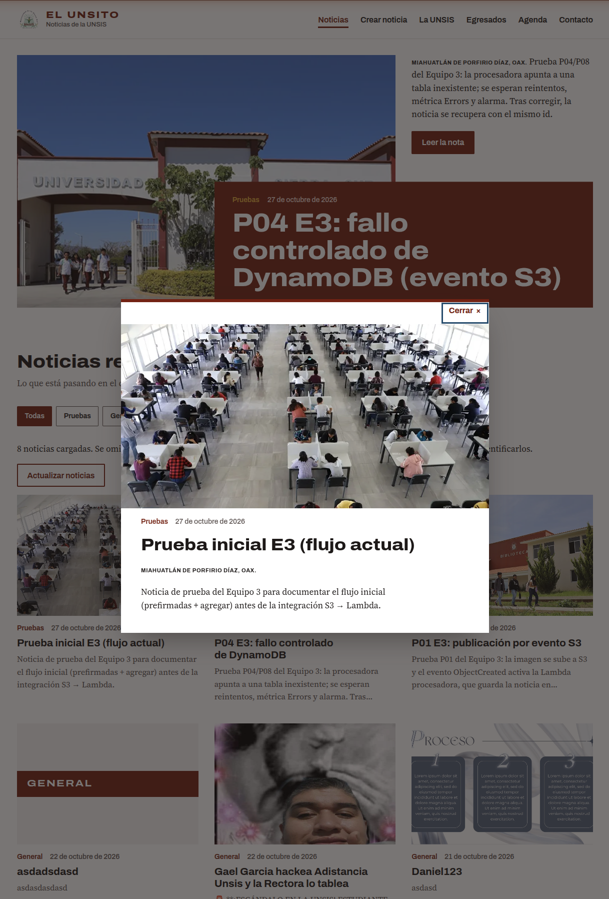

---

## Fase B · S3 → Lambda → DynamoDB

### B1. Respaldo y nueva versión de la Lambda de prefirmadas

1. Se abrió `cors` > **Código** y se transcribió el código desplegado a `lambdas/prefirmadas-original.mjs`, como respaldo.
2. Se reemplazó `index.mjs` por `lambdas/prefirmar-noticia.mjs` y se pulsó **Deploy**.
   - El modo anterior `POST ?file=nombre` se conserva sin cambios, para no interrumpir a quien tenga la página antigua en caché.
   - El modo nuevo recibe JSON con `id, titulo, detalle, fecha, categoria, alt, tipo`. Primero guarda `pendientes/ID.json` y después firma `imagenes/ID/foto.ext`.
3. Se verificó desde la terminal que los dos modos responden: el anterior devuelve `uploadUrl` y el nuevo valida los campos.

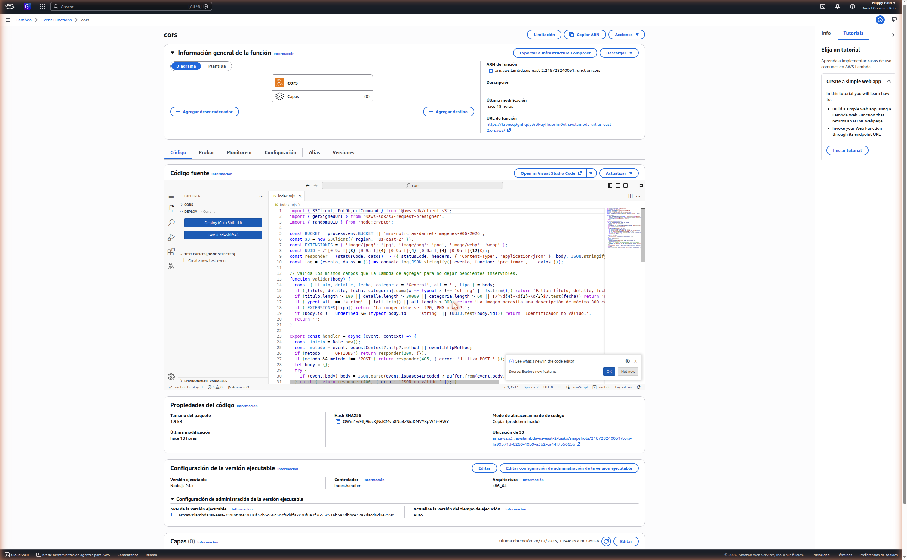

### B2. Crear la Lambda procesadora

1. En **Lambda > Create function > Crear desde cero** se configuró:
   - Nombre: `procesar-imagen-noticia`
   - Runtime: Node.js 24.x
   - En **Configuración adicional**, se activó **Rol de ejecución personalizada**, con **Use existing role** y `PowerUserRole`.

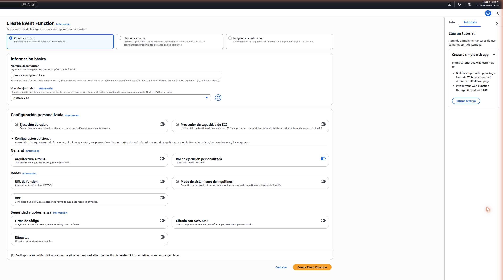

2. Se pegó `lambdas/procesar-imagen.mjs` en `index.mjs` y se pulsó **Deploy**.

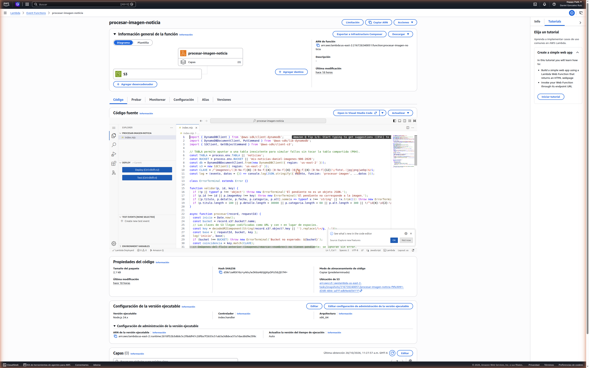

3. En **Configuración general**, el tiempo de espera pasó de 3 s a 30 s.
4. En **Variables de entorno** se agregaron `TABLA = noticias` y `BUCKET = mis-noticias-daniel-imagenes-906-2026`. La variable `TABLA` se usa después para simular un fallo sin tocar la tabla real.

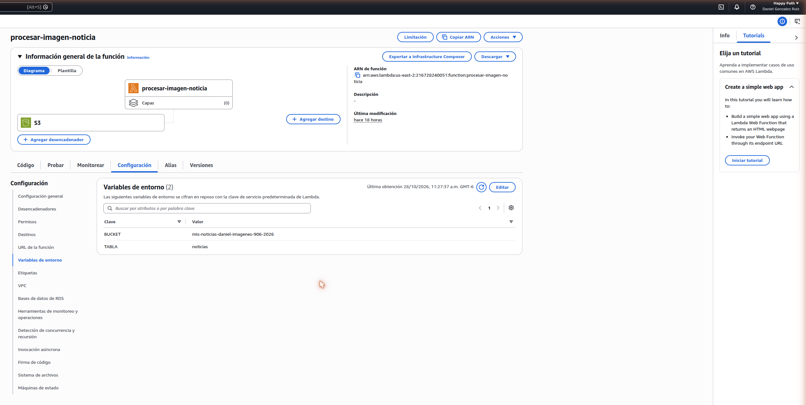

### B3. Disparador S3

1. En la procesadora se pulsó **Agregar desencadenador > S3** y se configuró:
   - Bucket: `mis-noticias-daniel-imagenes-906-2026`
   - Tipo de evento: **Todos los eventos de creación de objetos**
   - Prefijo: `imagenes/`
2. Se marcó el aviso de invocación recurrente. No hay ciclo, porque la procesadora solo lee de S3 y escribe en DynamoDB, y los pendientes están fuera del prefijo `imagenes/`.

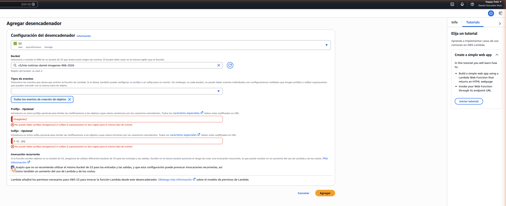

*En la recaptura, el formulario muestra en rojo «No puede haber prefijos superpuestos…» porque la regla ya existía. La recaptura se canceló sin guardar.*

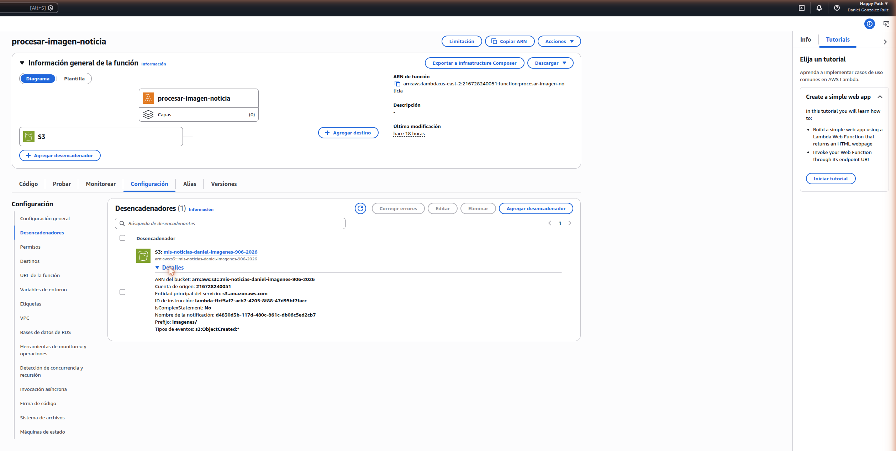

3. Lambda creó la política basada en recursos que permite a `s3.amazonaws.com` invocar la función, restringida por `AWS:SourceAccount` y `AWS:SourceArn` del bucket.

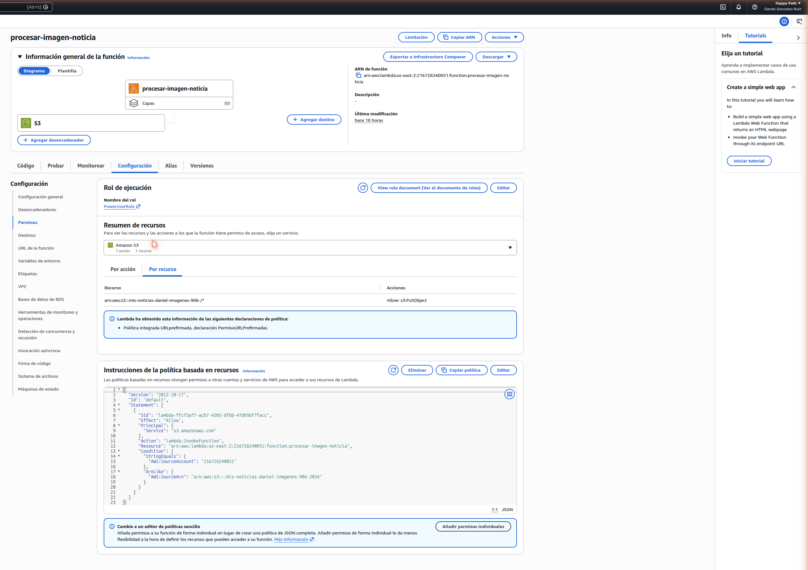

4. En **S3 > bucket > Propiedades > Notificaciones de eventos** aparece la regla con el filtro `imagenes/` y destino `procesar-imagen-noticia`.

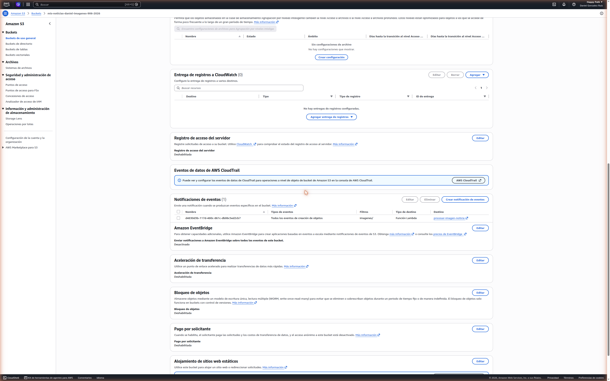

### B4. Consulta por id en `obtenerNoticias`
Se reemplazó el código por `lambdas/obtener-noticias.mjs` y se pulsó **Deploy**. Ahora `GET ?id=ID` usa `GetItem` con lectura consistente y responde `{"estado":"pendiente"}` o `{"estado":"publicada","item":…}`. El listado completo sigue funcionando igual.

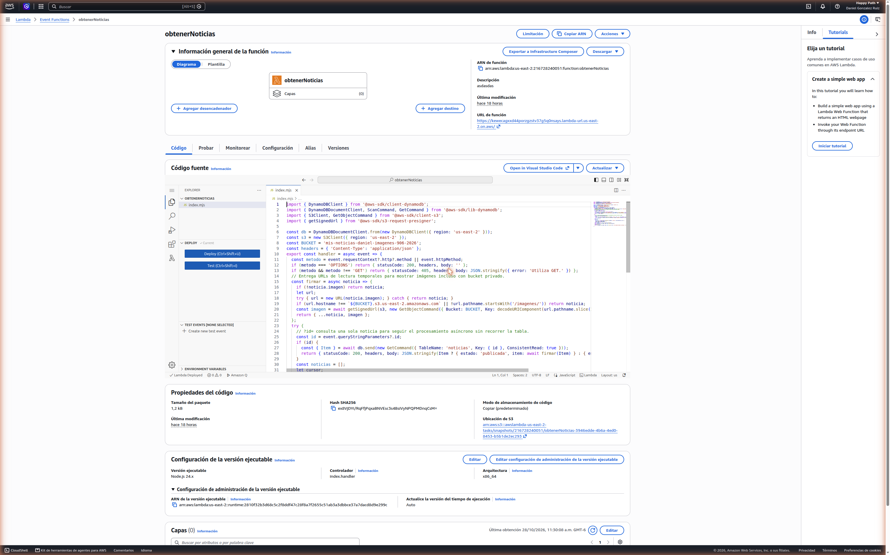

### B5. Publicar el frontend

1. En **S3 > 906-unsis-daniel > js/ > Cargar** se subió `js/main.js` con el metadato `Content-Type: application/javascript`.

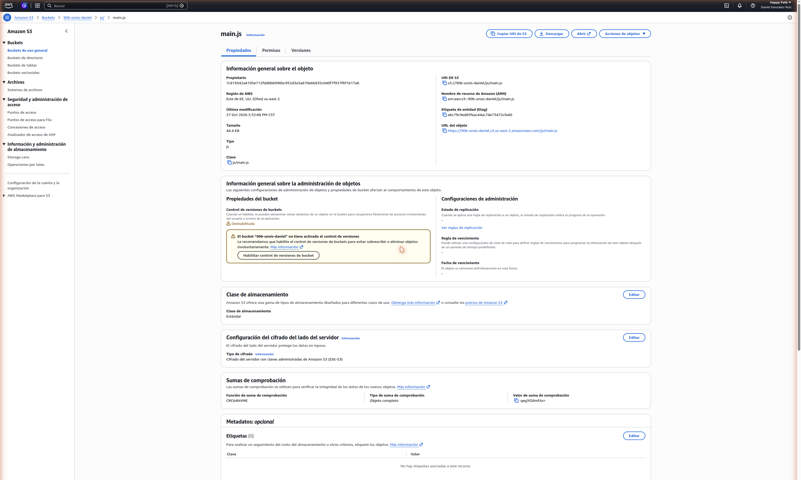

*La recaptura muestra el objeto `js/main.js` ya subido, con su fecha de modificación.*

2. **Problema encontrado:** el navegador seguía ejecutando el `main.js` anterior, porque `index.html` lo carga con un parámetro de versión fijo (`?v=noticias-compatibilidad-6`). Se cambió a `?v=noticias-s3-evento-1` en `index.html` y se subió también ese archivo. Las páginas guardadas en la caché del navegador siguen usando el flujo anterior hasta que caduca la caché, y por eso se mantuvo compatible el modo `?file=`.

---

## Fase C · Logs, métricas y alarma

### C1. Logs estructurados y retención
La procesadora registra una línea JSON por etapa (`inicio`, `validado`, `guardado`, `duplicado`, `validacion_fallida`, `omitido_sin_formato` y `fallo`) con `requestId`, `bucket`, `key`, `noticiaId` y `duracionMs`. No registra firmas ni el contenido de la noticia.

En **CloudWatch > Grupos de registros > /aws/lambda/procesar-imagen-noticia > Acciones > Editar configuración de retención** se eligieron 3 días.

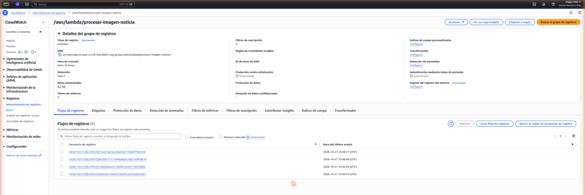

### C2. Invocación asíncrona
En **Configuración > Invocación asíncrona** se fijó la antigüedad máxima del evento en 1 hora, con 2 reintentos. No se configuró cola de mensajes fallidos (DLQ); queda como mejora opcional.

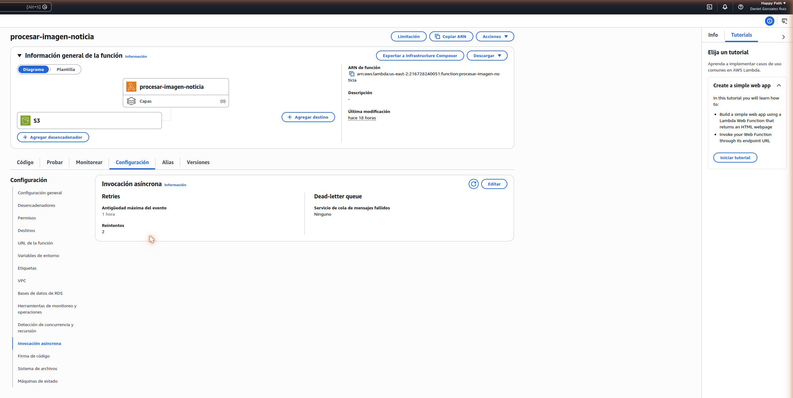

### C3. Alarma de errores
En **CloudWatch > Alarmas > Crear alarma** se configuró:

- Métrica: `AWS/Lambda` · `Errors` · `FunctionName = procesar-imagen-noticia`
- Estadística: Suma; periodo: 1 minuto; condición: mayor o igual que 1; puntos de datos: 1 de 1
- Datos faltantes: tratados como correctos (dentro del límite)
- Sin acciones. No se configuró SNS para no generar suscripciones de correo; puede agregarse en **Acciones > Notificación**.
- Nombre: `gaceta-procesadora-errores`

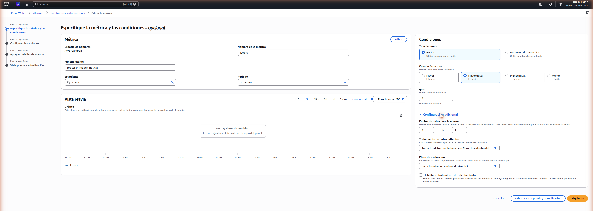
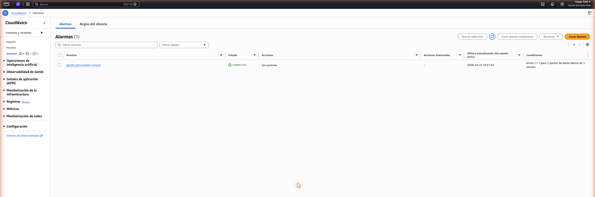

### C4. Rol de mínimo privilegio para la procesadora
Al principio, la procesadora usaba `PowerUserRole`. Ese rol tiene `PowerUserAccess`, que da muchos más permisos de los necesarios. El 28 de octubre se creó un rol propio solo con lo que la función usa. La política está en `documentacion/iam/procesadora-politica.json`.

| Permiso | Recurso | Para qué |
|---|---|---|
| `logs:CreateLogGroup` | `arn:aws:logs:us-east-2:216728240051:*` | Crear su grupo de logs |
| `logs:CreateLogStream`, `logs:PutLogEvents` | `/aws/lambda/procesar-imagen-noticia:*` | Escribir solo en sus propios logs |
| `s3:GetObject` | `mis-noticias-daniel-imagenes-906-2026/pendientes/*` | Leer el JSON de la noticia; no puede leer imágenes ni el resto del bucket |
| `s3:ListBucket` con condición `s3:prefix = pendientes/*` | el bucket de imágenes | Que un pendiente ausente responda `NoSuchKey` y no `AccessDenied`, para tratarlo como fallo terminal (P03) |
| `dynamodb:PutItem` | `table/noticias` | Guardar la noticia; no puede leer, borrar ni recorrer la tabla |

1. En **IAM > Roles > Crear rol** se eligió **Servicio de AWS** y **Lambda** como entidad de confianza.

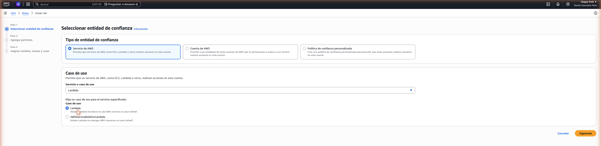

2. No se agregó ninguna política administrada. Se le puso el nombre `procesar-imagen-noticia-rol` y las etiquetas `proyecto=NoticiasAWS`, `equipo=3` y `entorno=Laboratorio`. La consola no acepta el carácter `>` en la descripción.

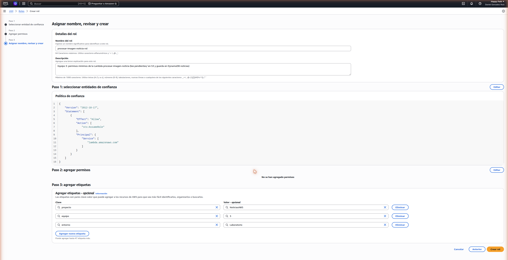

3. En el rol se usó **Agregar permisos > Crear política insertada > JSON** para pegar la política. El validador de IAM indica 0 problemas de seguridad, 0 errores y 0 advertencias.

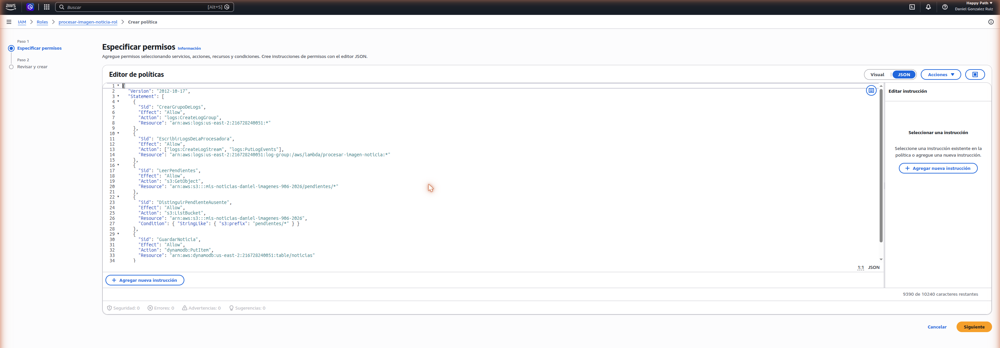
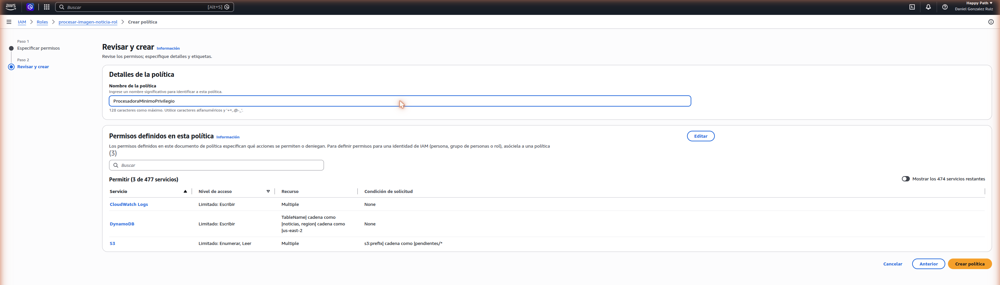

4. La política quedó guardada como `ProcesadoraMinimoPrivilegio`, y es la única del rol.

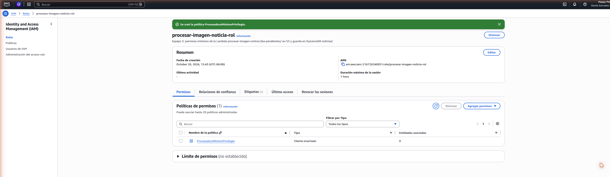

5. En la procesadora, en **Configuración general > Editar > Rol de ejecución**, se eligió `procesar-imagen-noticia-rol`.

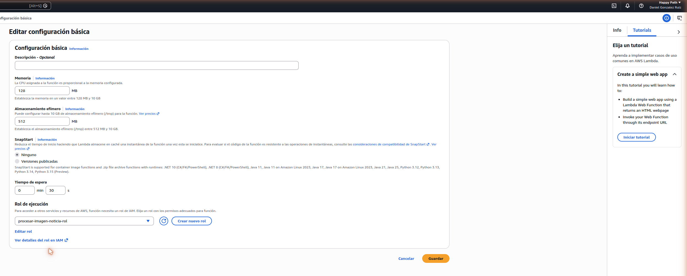
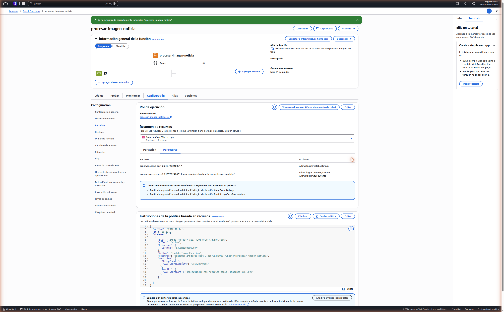

6. **Verificación con el rol mínimo:** se volvieron a ejecutar P07 y P03 con «Probar».
   - P07 dio `inicio` → `validado` → `duplicado`: la función lee el pendiente y la escritura condicional responde.
   - P03 dio `validacion_fallida` por `NoSuchKey`.

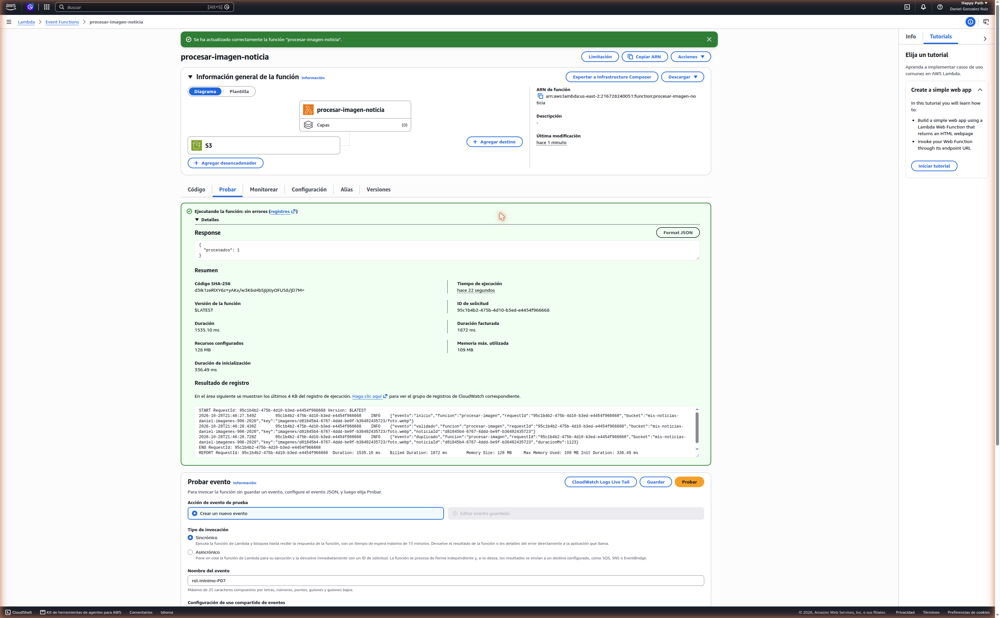
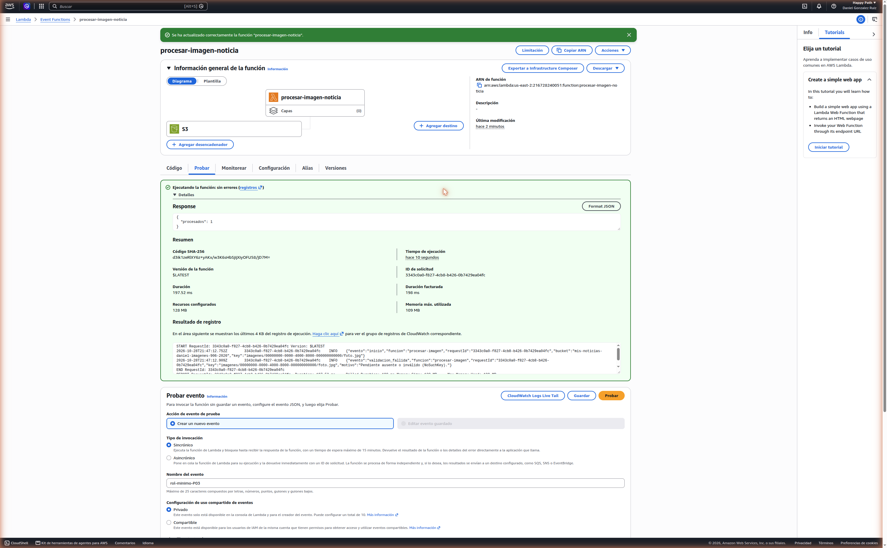

`PowerUserRole` no se modificó, porque lo siguen usando `cors`, `agregarNoticia` y `obtenerNoticias`. Para un entorno real, conviene darle a cada una su propio rol mínimo.

### C5. Etiquetas de costos
Como pide el documento del proyecto, se etiquetaron con `proyecto=NoticiasAWS`, `equipo=3` y `entorno=Laboratorio` los tres recursos que creó el Equipo 3:
- la procesadora;
- su rol;
- la alarma.

Los recursos compartidos (bucket, tabla y Lambdas originales) no se tocaron.

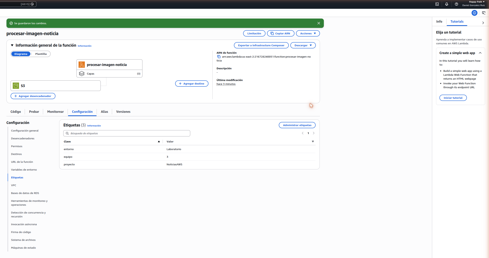
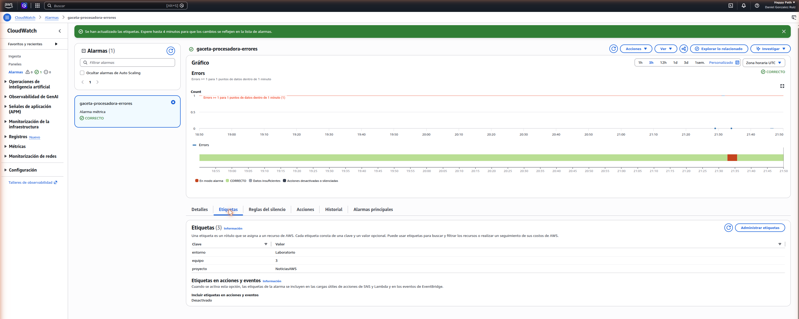

---

## Fase D · Pruebas P01–P08

### P01 · Imagen válida
Se publicó «P01 E3: publicación por evento S3» con imagen desde el sitio. En el tráfico de red solo aparecen el POST a prefirmadas, el PUT a S3 y GET `?id=`; **no hay ninguna llamada a `agregarNoticia`**. El `noticiaId` fue `d81845b4-6767-4ddd-be9f-b36492435723`.

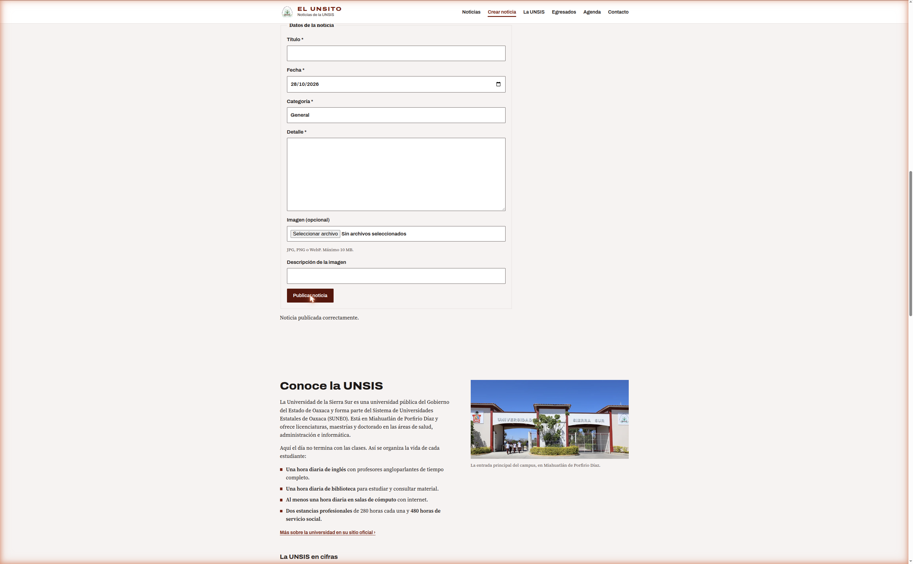

*Para la captura en alta resolución, P01 se repitió el 28 de octubre con «P01 E3 (repetición)», id `c544c655-5ee9-4cfc-80e5-130237631061`. Tampoco hubo ninguna llamada a `agregarNoticia`.*

Los logs de la procesadora muestran `inicio` → `validado` → `guardado`, con una duración de 1 561 ms.

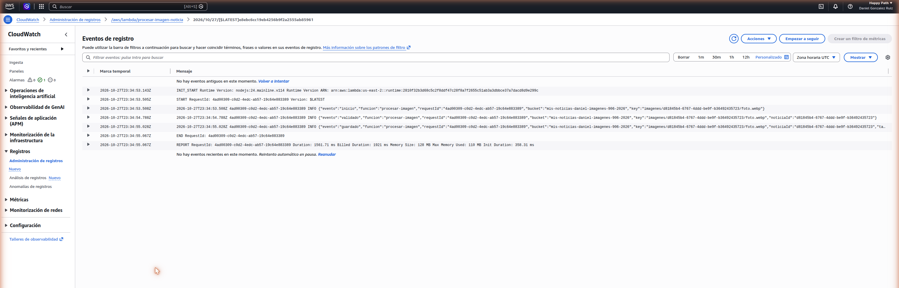

### P02 · Persistencia
El elemento está en DynamoDB con `origen = s3-evento` y la URL de la imagen sin firma. Al recargar el sitio, la noticia se abre con su imagen.

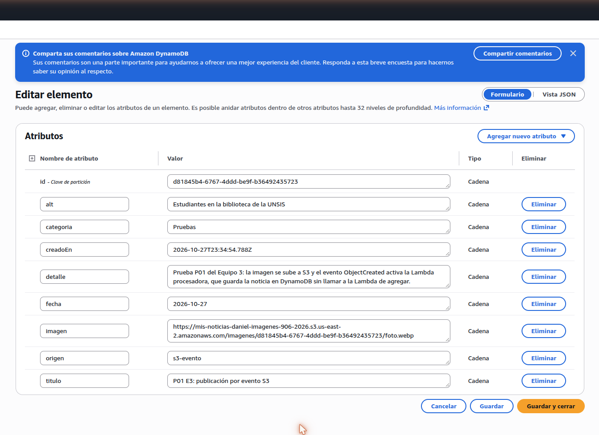
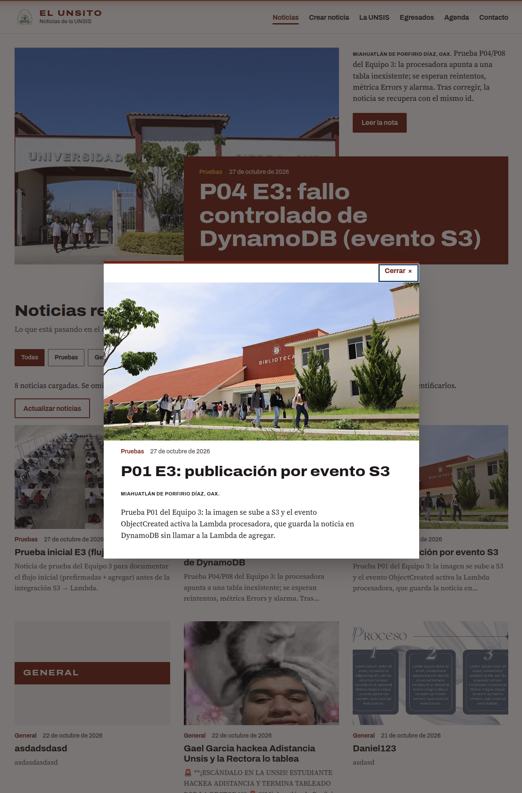

### P03 · JSON ausente
Se probó la procesadora en **Probar** con `pruebas/evento-s3-sin-pendiente.json`. El log registra `validacion_fallida` con «Pendiente ausente o inválido (NoSuchKey)». La función termina sin error, porque es un fallo terminal que no se reintenta, y no se crea ningún registro.

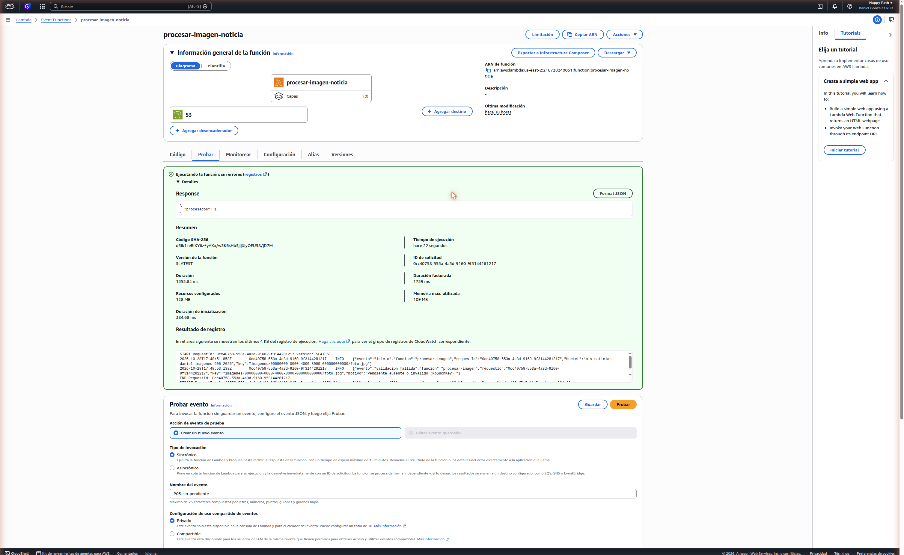

### P04 · Fallo de DynamoDB simulado

1. Se cambió `TABLA` a `noticias-falla-lab`, una tabla que no existe. La tabla real no se tocó.

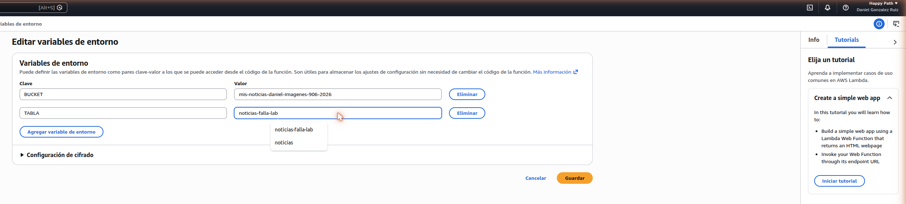

2. Se publicó «P04 E3: fallo controlado de DynamoDB (evento S3)», con id `a082e96b-a1b7-40da-bade-06677ac730ca`.
3. El log muestra **3 intentos con el mismo requestId** (23:45:50, 23:46:54 y 23:48:48 UTC), es decir, el intento inicial más 2 reintentos. Los tres fallan con `ResourceNotFoundException`.

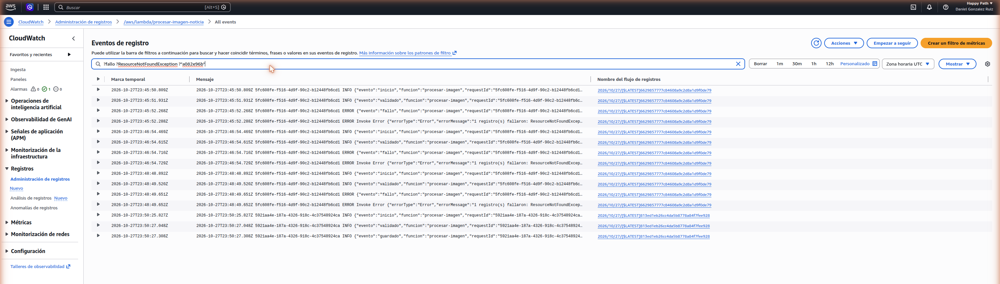

4. **Recuperación:** se restableció `TABLA = noticias` y se reprocesó el evento con `pruebas/evento-s3-recuperacion-p04.json`. El log registra `guardado` con el mismo id.

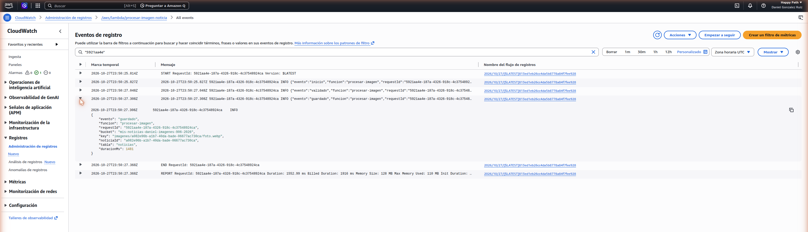

### P05 · Métrica Errors
En la pestaña **Monitorear** de la procesadora, la métrica nativa `Errors` alcanza 1, con una tasa de éxito mínima del 0 %. En «Eventos asincrónicos» se ven 3 eventos recibidos y 1 eliminado tras agotar los reintentos.

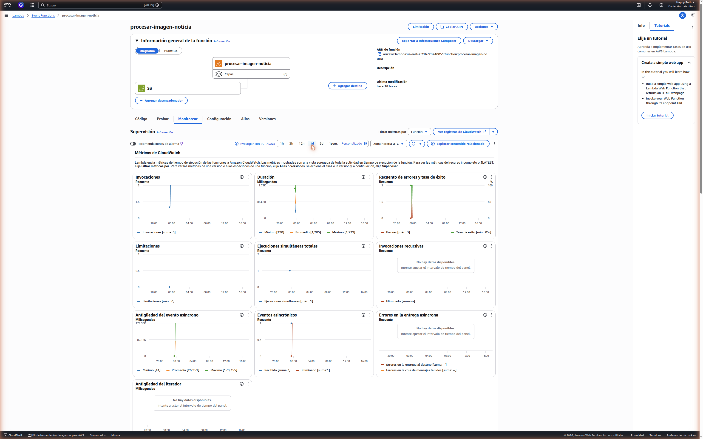

### P06 · Alarma
La alarma pasó a **En modo alarma** a las 23:46:42 UTC.

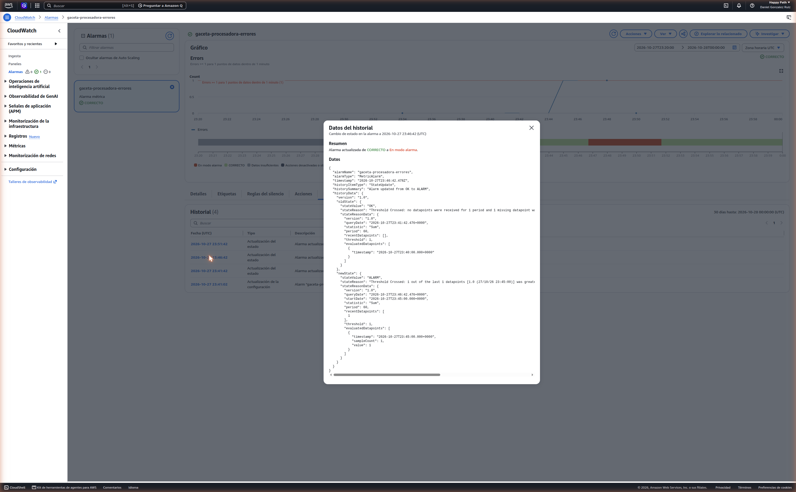

Tras la recuperación volvió a **CORRECTO** a las 23:51:42 UTC.

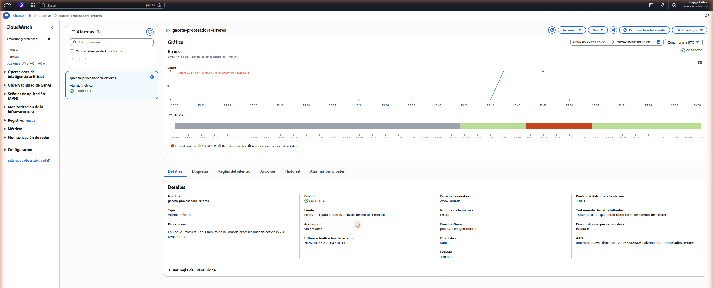

En la pestaña **Historial** de la alarma quedan registradas las transiciones de estado.

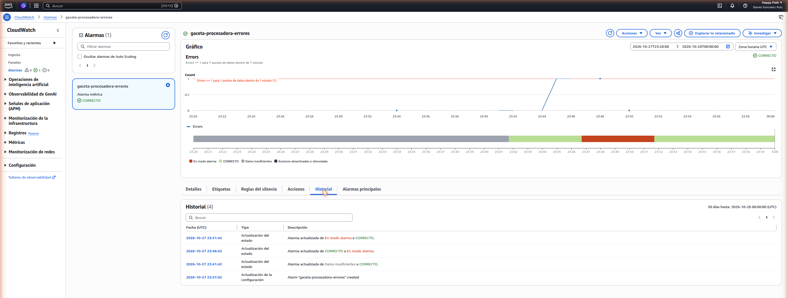

### P07 · Evento duplicado
Se volvió a enviar el evento de la imagen de P01 (`pruebas/evento-s3-duplicado.json`). El log registra `duplicado` con el mismo `noticiaId`, y DynamoDB conserva un solo registro.

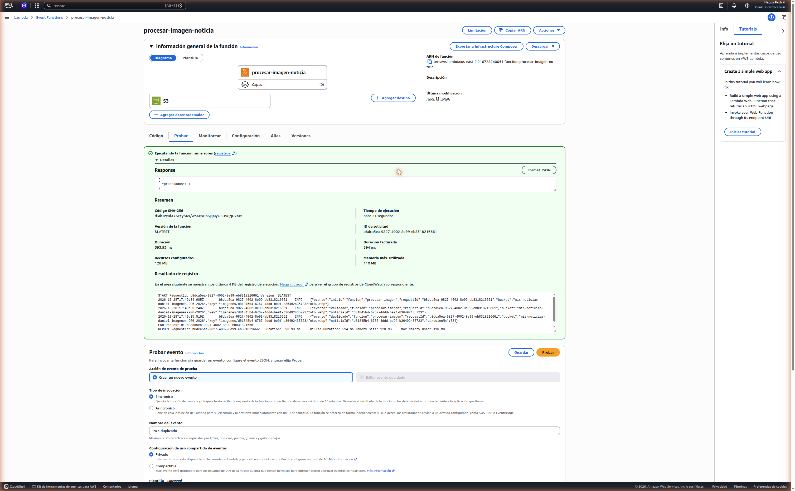

### P08 · Procesamiento lento
Durante el fallo de P04, la web consultó el estado 10 veces por id y mostró «La imagen se subió y la noticia sigue en procesamiento», sin reenviar la noticia.

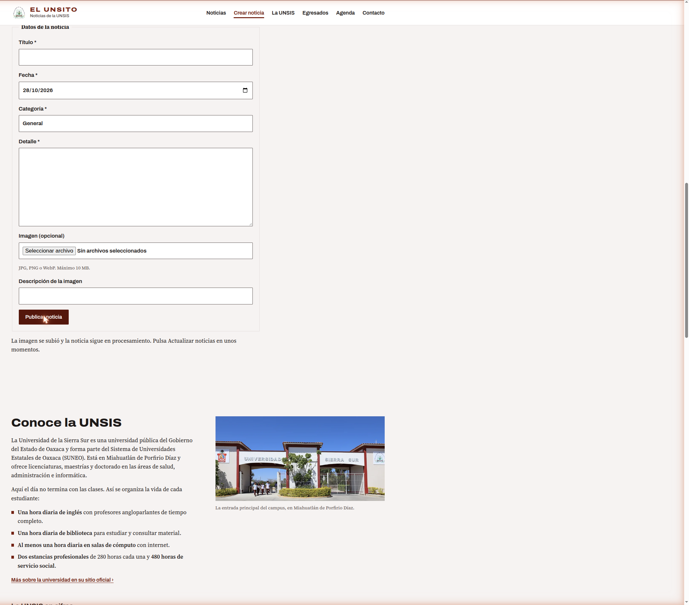

*Para la captura en alta resolución, P08 se repitió el 28 de octubre con «P08 E3 (repetición)», id `7c32f756-55cc-4555-a93a-dbc4afe843c5`, de nuevo con `TABLA = noticias-falla-lab`. Al restaurar `TABLA = noticias`, uno de los reintentos automáticos guardó la noticia a las 21:34 UTC sin reprocesarla a mano.*

Tras la recuperación, la noticia aparece una sola vez.

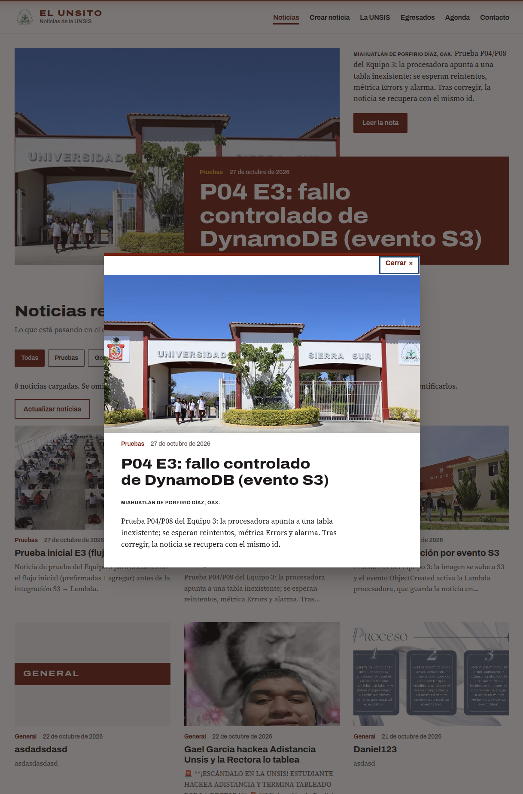

---

## Fase E · Cierre y costos

Saldo final: 120,00 USD en créditos y 0,00 USD de gasto en el mes. Lambda, S3, DynamoDB bajo demanda y CloudWatch quedaron dentro del nivel gratuito.

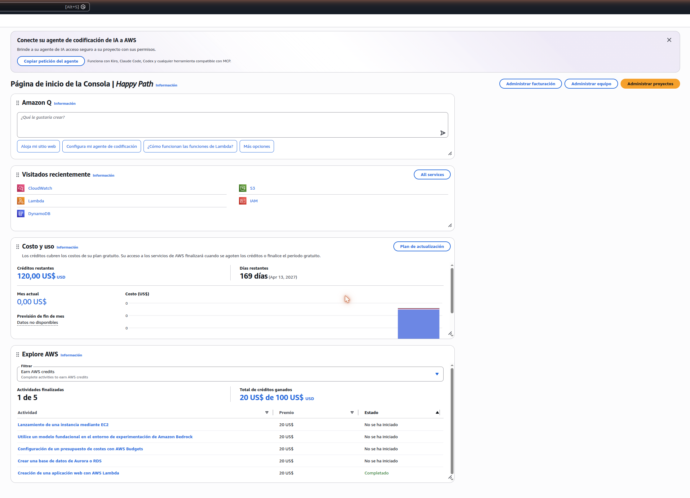

**Recursos creados:**

- Función `procesar-imagen-noticia`
- Rol `procesar-imagen-noticia-rol` con la política insertada `ProcesadoraMinimoPrivilegio`
- Disparador S3
- Alarma `gaceta-procesadora-errores`
- Grupo de logs con retención de 3 días

**Registros de prueba en la tabla `noticias`:**

| Id | Título | Origen |
|---|---|---|
| fc25af5a-82be-4ec4-bc0b-8c874bb986e8 | Prueba inicial E3 (flujo actual) | HTTP |
| d81845b4-6767-4ddd-be9f-b36492435723 | P01 E3 | evento S3 |
| a082e96b-a1b7-40da-bade-06677ac730ca | P04 E3 (evento S3) | evento S3 |
| 8059b64e-5245-4fcd-a86c-1b6285bffec2 | P04 E3 | HTTP; se publicó desde la página en caché |
| c544c655-5ee9-4cfc-80e5-130237631061 | P01 E3 (repetición, 28 oct.) | evento S3 |
| 7c32f756-55cc-4555-a93a-dbc4afe843c5 | P08 E3 (repetición, 28 oct.) | evento S3, guardada por reintento |

No se borró nada de la tabla compartida. Si el equipo decide retirar los registros de prueba, puede hacerlo desde **Explorar elementos**.

**Limpieza al terminar el curso**, en este orden:

1. Quitar el disparador S3 de la procesadora.
2. Eliminar la función `procesar-imagen-noticia`.
3. Eliminar el rol `procesar-imagen-noticia-rol`.
4. Eliminar la alarma `gaceta-procesadora-errores`.
5. Eliminar el grupo de logs `/aws/lambda/procesar-imagen-noticia`.
6. Eliminar los objetos `pendientes/` y las imágenes de prueba del bucket.
7. Eliminar las noticias de prueba de la tabla.

Si el sitio sigue en uso, antes hay que restaurar `lambdas/prefirmadas-original.mjs` en `cors`.

**Pendientes opcionales:**

- DLQ o destino SQS para fallos.
- Notificación SNS de la alarma.
- Regla de ciclo de vida que caduque `pendientes/` a los 7 días.
- Retirar el modo `?file=` y la Lambda `agregarNoticia` para imágenes cuando ya no queden páginas antiguas en caché.
